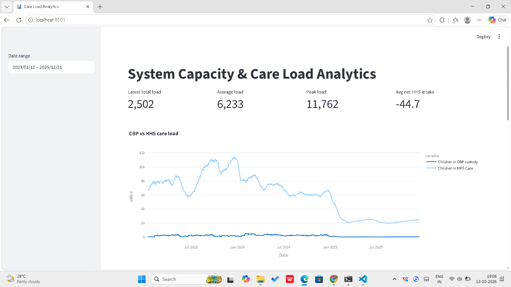
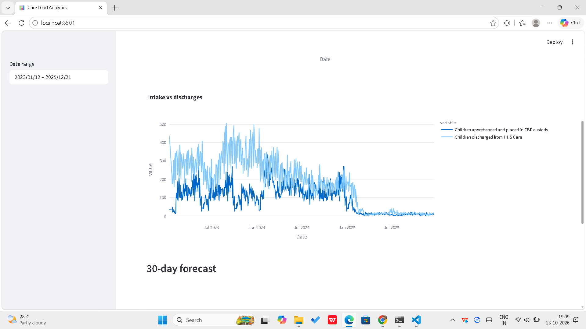
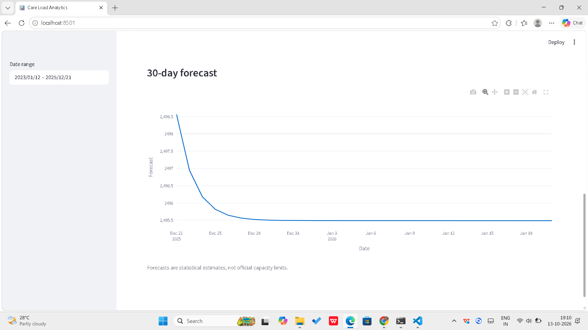

# System Capacity & Care Load Analytics for Unaccompanied Children

An end-to-end analytics and forecasting project that monitors care load across the CBP and HHS stages of the Unaccompanied Alien Children (UAC) program, identifies periods of capacity strain and relief, and forecasts total system load 30 days ahead. Results are presented in an interactive Streamlit dashboard.

**Live dashboard:** [https://systemcapacityanalytics-online.streamlit.app/]
**Internship:** Unified Mentor, Machine Learning

## Problem Statement

Daily operational data exists, but there is no central framework to continuously assess total care load, the balance between inflow and outflow, periods of capacity stress and relief, and the sustainability of care delivery. This project builds that framework.

## Objectives

- Quantify daily and cumulative care load across CBP and HHS
- Identify periods of capacity strain and relief
- Analyse the balance between intake, transfers and discharges
- Support staffing and shelter planning with trend and forecast information

## Dataset

720 daily records between 12 Jan 2023 and 21 Dec 2025. 355 of the 1,075 calendar days in that range have no report; gaps were interpolated for forecasting only, never filled with zero.

| Column | Description |
|---|---|
| Date | Reporting date |
| Children apprehended and placed in CBP custody | Daily intake volume |
| Children in CBP custody | Active CBP care load |
| Children transferred out of CBP custody | Flow into HHS |
| Children in HHS Care | Active HHS care load |
| Children discharged from HHS Care | Sponsor placements |

## Methodology

1. **Ingestion and structuring:** parsed dates, sorted chronologically, standardised column names (hidden characters, footnote asterisks, spacing).
2. **Quality and validation:** checked missing and duplicate dates and missing calendar days; flagged days where transfers exceed CBP custody or discharges exceed HHS care.
3. **Derived metrics:**
   - Total System Load = CBP custody + HHS care
   - Net HHS Intake = transfers out of CBP − discharges from HHS
   - Daily change and growth rate (%)
   - 7-day and 14-day rolling averages
   - Sustained HHS Pressure (positive net intake on at least 5 of the last 7 days)
4. **Trend and temporal analysis:** daily, weekly and monthly trends; early vs late timeline comparison.
5. **Pressure identification:** strain = 7-day average load in the top 25% of the period, relief = bottom 25%; runs of 14+ strain days reported as prolonged strain windows.
6. **Forecasting:** chronological 80/20 split, naive baseline vs ARIMA(1,1,1), evaluated with MAE and RMSE, then refit on all data for a 30-day forecast.

## KPIs

| KPI | Meaning | Latest value |
|---|---|---|
| Total Children Under Care | System-wide responsibility | 2,502 |
| Net Intake Pressure | Inflow vs outflow imbalance (avg per day) | -44.7 |
| Care Load Volatility Index | 7-day standard deviation / 7-day average | 0.020 |
| Backlog Accumulation Rate | 7-day average of net HHS intake | -1.3 |
| Discharge Offset Ratio | Total discharges / total transfers | 1.35 |

Peak total system load: 11,762. Average: 6,233.

## Key Findings

- Load peaked at 11,762 around the turn of 2023 to 2024 and fell sharply in early 2025 to about 2,500.
- Three prolonged strain windows were found: 1 to 23 May 2023, 7 Aug 2023 to 22 Jan 2024 (169 calendar days) and 25 Jan to 27 Mar 2024 (63 calendar days). No prolonged strain appears after March 2024.
- Discharges exceeded transfers on average, and load swings are small (volatility 0.020), so no backlog is building.
- Average load fell from 8,615 in the first half of the timeline to 3,864 in the second half; net HHS intake moved from -88.3 to -1.4 per day.
- A naive baseline beat ARIMA(1,1,1) on the held-out period, so the 30-day forecast is a stable-level estimate (about 2,495 to 2,499 children).

## Forecast Results

| Model | MAE | RMSE |
|---|---|---|
| Naive baseline | 229.36 | 284.48 |
| ARIMA(1,1,1) | 245.12 | 301.98 |

The naive baseline performed slightly better (MAE about 7% lower). The test period is a stable low-load stretch where repeating the last value is hard to beat, so ARIMA(1,1,1) added no value on this split. SARIMA or lag-feature models are the next step.

## Dashboard

- Date range selector
- Time granularity filter (daily, weekly, monthly)
- Metric toggles
- System load overview, CBP vs HHS comparison, net intake and backlog trends
- KPI summary cards
- Strain and relief periods table
- 30-day forecast with CSV download





## Project Structure

```
system_capacity_analytics/
├── app.py                 Streamlit dashboard
├── data/                  raw, cleaned and forecast CSV files
├── notebooks/EDA.ipynb    cleaning, EDA, KPIs and forecasting
├── images/                dashboard screenshots
├── report/                research paper and executive summary
├── requirements.txt
└── README.md
```

## How to Run Locally

```bash
git clone https://github.com/Reena-1-1/system_capacity_analytics.git
cd system_capacity_analytics
python -m venv venv
venv\Scripts\activate
pip install -r requirements.txt
python -m streamlit run app.py
```

## Limitations

- The dataset has counts of children, not bed or shelter capacity, so the project identifies pressure periods but cannot prove overcrowding.
- Rolling averages, the volatility index, the backlog rate and strain windows are computed over the last 7 or 14 reported records, not calendar days, because 33% of calendar days have no report.
- On 86 reported days, transfers exceeded the recorded CBP custody count; daily flows and end-of-day counts may follow different reporting conventions; flagged rows are quality indicators, not confirmed errors.
- ARIMA(1,1,1) is a starting configuration and was not exhaustively tuned.
- Forecasts are statistical estimates, not official projections.

## Future Improvements

SARIMA with weekly seasonality, lag-feature machine learning models, alert thresholds, and automated data refresh.

## Author

Reena, Machine Learning Internship, Unified Mentor